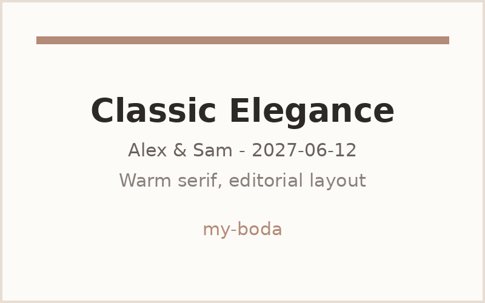
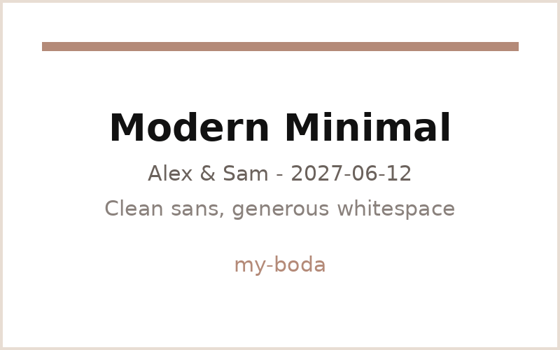
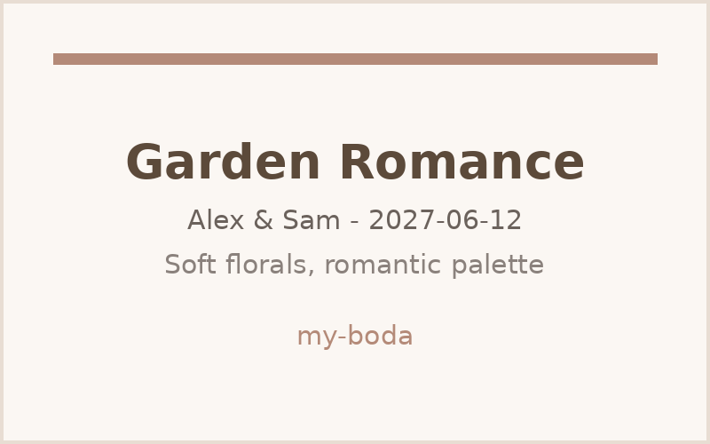

# my-boda — Private, Self-Hosted Wedding Website

> **Your wedding is private. Your data should be too.**

An open-core, self-hosted wedding platform — no tracking, no vendor lock-in, no guest data sold. You own the site, the database, and the domain. Deploy in one click or `docker-compose up` on any VPS.

<p align="center">
  
</p>

<p align="center">

[](https://vercel.com/new/clone?repository-url=https://github.com/your-org/my-boda)
[](https://railway.app/template/github/your-org/my-boda)

</p>

---

## Themes

Three handcrafted themes — switch with a single env var, no rebuild of content required. All themes share the same data layer and are fully responsive.

| Classic Elegance | Modern Minimal | Garden Romance |
|---|---|---|
|  |  |  |
| Warm serif, editorial layout | Clean sans, generous whitespace | Soft florals, romantic palette |
| `NEXT_PUBLIC_THEME=classic` | `NEXT_PUBLIC_THEME=modern` | `NEXT_PUBLIC_THEME=garden` |

> GIF placeholders — replace `docs/assets/theme-*.gif` with screen recordings of each theme. See [docs/THEMES.md](docs/THEMES.md) for how to add a new theme.

---

## Quick Start

```bash
git clone https://github.com/your-org/my-boda.git
cd my-boda
cp .env.example .env   # edit couple name, date, venue, passwords
docker compose up --build -d
# → http://localhost:3000
```

Local without Docker:

```bash
npm ci
npx prisma migrate dev
npx prisma db seed   # optional demo guests
npm run dev          # http://localhost:3000
```

Admin dashboard: `http://localhost:3000/admin` — password from `ADMIN_PASSWORD` in `.env`.

---

## Features

| # | Feature | What it does |
|---|---------|--------------|
| 1 | **Landing & Themes** | Hero countdown, couple story, 3-theme switcher (`classic` / `modern` / `garden`), accent color override |
| 2 | **Smart RSVP** | Conditional form (attending → headcount/meal/dietary), Zod-validated, idempotent upsert by guest, confirmation feedback |
| 3 | **Admin Dashboard** | HMAC-hashed password auth, httpOnly session cookie (7-day expiry), guest table with search/filter, stats, CSV export, polling refresh, logout |
| 4 | **Logistics Hub** | `/info` — schedule timeline, venue map embed, accommodations list, all driven by `*_JSON` env vars |
| 5 | **Registry & Gifts** | `/registry` — IBAN/Bizum + external gift links, configurable message, no payment processing (privacy-first) |

All copy is env-driven — no hardcoded couple data in the repo.

---

## Self-Hosting vs Cloud

| | **Self-Hosted (this repo, MIT)** | **Cloud (planned Phase 2)** |
|---|---|---|
| **Hosting** | Your VPS / NAS / Raspberry Pi | Managed on my-boda.cloud |
| **Cost** | ~€3–5/mo VPS + domain (~€10/yr) | Flat-fee one-time pass (no per-guest fees) |
| **Data** | 100% yours — SQLite/Postgres on your disk, no telemetry | Same privacy promise, backups included |
| **Domain** | Your custom domain via reverse proxy | Custom domain included |
| **Updates** | `git pull && docker compose up --build -d` | Automatic |
| **Support** | Community (GitHub Issues/Discussions) | Email support |
| **Best for** | Privacy-conscious, technical couples, EU/GDPR peace of mind | Non-technical couples who want zero ops |

> Phase 1 is fully self-hosted and free. The cloud offering is a future convenience layer — not a paywall for features.

---

## Environment Variables

All variables are documented in [`.env.example`](.env.example). Copy it to `.env` and edit.

| Variable | Scope | Default | Description |
|---|---|---|---|
| `NEXT_PUBLIC_COUPLE_NAME` | public | `Alex & Sam` | Couple display name |
| `NEXT_PUBLIC_WEDDING_DATE` | public | `2027-06-12` | Wedding date `YYYY-MM-DD` (countdown + display) |
| `NEXT_PUBLIC_VENUE` | public | `Villa del Sol, Barcelona` | Venue display name |
| `NEXT_PUBLIC_THEME` | public | `classic` | Theme id: `classic` \| `modern` \| `garden` |
| `NEXT_PUBLIC_ACCENT` | public | `#b48a78` | Accent hex color |
| `NEXT_PUBLIC_SCHEDULE_JSON` | public | `""` | Schedule timeline `[{time,title,description?}]` |
| `NEXT_PUBLIC_ACCOMMODATIONS_JSON` | public | `""` | Accommodations `[{name,url?,note?}]` |
| `NEXT_PUBLIC_REGISTRY_JSON` | public | `""` | Registry `{iban?,bizum?,links:[{label,url}],message?}` |
| `NEXT_PUBLIC_VENUE_MAP_URL` | public | `""` | Google/Apple Maps URL for `/info` |
| `DATABASE_URL` | server | `file:./data/dev.db` (`file:/app/data/dev.db` in Docker) | SQLite (default) or `postgresql://…` |
| `ADMIN_PASSWORD` | server | `admin123` | Admin dashboard password (HMAC-hashed, httpOnly cookie) |

`NEXT_PUBLIC_*` vars are inlined at build time — rebuild after changing them (`docker compose up --build`).

---

## Tech Stack

| Layer | Technology | Version |
|---|---|---|
| Framework | [Next.js](https://nextjs.org) (App Router, Turbopack) | `16.3.4` |
| UI | React `19.1.1`, Tailwind CSS `4.3.3`, `@tailwindcss/postcss` `4.3.3` | latest |
| Database | Prisma `7.10.0` + `@prisma/adapter-better-sqlite3` `7.10.0` (driverAdapters) | `7.10.0` |
| SQLite driver | `better-sqlite3` `13.0.3` (`@types/better-sqlite3` `9.6.0`) | `13.0.3` |
| Validation | Zod `4.5.4` | `4.5.4` |
| Dates | `date-fns` `4.4.0` | `4.4.0` |
| CSV | `papaparse` `5.4.1` | `5.4.1` |
| Language | TypeScript `5.4.5` | `5.4.5` |
| Container | Docker + `docker-compose.yml` (Node 20 Alpine) | — |

Prisma uses the **driverAdapters** pattern: `datasource db { provider = "sqlite" }` has no `url` — the URL lives in `prisma.config.ts` for CLI and `src/lib/prisma.ts` (`new PrismaBetterSqlite3({ url })`) for runtime.

---

## Documentation

- [Self-Hosting Guide](docs/SELF_HOSTING.md) — Docker, env, reverse proxy, custom domain, migration, backup
- [Themes Guide](docs/THEMES.md) — how themes work, `ThemeDef` shape, adding a new theme
- [`.env.example`](.env.example) — all env vars with comments

---

## Contributing

Contributions welcome — bug fixes, themes, translations, docs.

```bash
git clone https://github.com/your-org/my-boda.git
cd my-boda
npm ci
npx prisma generate
npm run dev
```

- Run `npm run build` and `npm run lint` before opening a PR.
- For new themes, follow [docs/THEMES.md](docs/THEMES.md).
- Open an issue first for large changes so we can discuss scope.

---

## License

MIT — self-hosted core is free and open. See [LICENSE](LICENSE). You may self-host, fork, and modify freely. A future managed cloud offering may add paid convenience features without restricting the open core.

---

## Footer

Made with care for couples who value privacy. Your wedding is private. Your data should be too.

> Attribution note: built as an open-core wedding platform. If you self-host, a small footer attribution link is appreciated but not required — remove it in `src/components/Header.tsx` / `Footer` if you prefer.

